<div align="center">
  
  <h1>BengkelKu — Smart Workshop Management</h1>
  <p>
    <strong>End-to-end Android workshop booking, service order, spare-part inventory, and invoicing system built with Flutter &amp; Firebase.</strong>
  </p>
  <p>
    <em>Crisp Automotive Edition • Role-Based Access Control (Customer, Admin/Cashier, Technician) • Cloud Firestore Transactions</em>
  </p>
</div>

---

## Overview

**BengkelKu** (`bengkel_kendaraan`) digitizes automotive workshop operations into a unified real-time mobile experience powered by **Flutter**, **Riverpod**, **GoRouter**, **Firebase Authentication**, and **Cloud Firestore**.

The interface follows the **Crisp Automotive** design language—combining pure white (`#FFFFFF`) and warm canvas (`#F5F6F8`) surfaces with high-contrast Midnight Carbon (`#111827`) spotlight cards, Automotive Orange (`#EA580C`) highlights, universal motorcycle/car vehicle iconography, Indonesian license plate badges, and floating pill navigation tailored per role.

<p align="center">
  
  &nbsp;&nbsp;&nbsp;&nbsp;
  
</p>

---

## Key Features by Role

### Customer
- **Email Authentication & Verification**: Self-registration, email verification gate, and password reset (`LoginScreen`, `AccountScreen`, `ProfileScreen`).
- **Personal Vehicle Garage**: Add, edit, and soft-archive motorcycles or cars with automatic Indonesian license plate normalization (`B 1234 XYZ`).
- **Hourly WIB Booking Slots**: Collision-free hourly visit booking (`09:00–16:00 WIB`, up to 90 days ahead) locked atomically via `bookingSlots`.
- **Realtime Tracking, History & PDF Invoices**: Segmented `Progres | Riwayat | Invoice` flow with live service stage visualization and itemized receipts.

### Admin / Cashier
- **Operational Carbon Dashboard**: Real-time KPI summary (active service orders, pending bookings, jobs awaiting final approval, and low-stock SKUs).
- **Booking & Technician Dispatch**: Confirm or reject bookings, create `ServiceOrder` records, inspect checklist/work logs, and assign available technicians.
- **2-Step Approval Workflow**: Approve technician spare-part requests (`partRequests`) and review completion submissions (`awaitingApproval`) before finalizing an order.
- **Atomic Spare-Part Inventory & Ledger**: SKU search, low-stock tracking, and immutable `stockMovements` audit trails with full reversal support.
- **Billing, Cashier & Reporting**: Issue canonical invoices (`INV~...`), record cash or transfer payments, execute void/full refund operations, generate PDF receipts, and query paid revenue summaries (up to 31-day windows).

### Technician
- **Focused Task Spotlight**: Active vehicle spotlight card with Indonesian plate pill and 3-stage progress strip (`Menunggu → Diproses → Selesai`).
- **Checklist, Diagnosis & Actions**: Structured pre-work, safety, and quality inspection checklist saved with optimistic revision locking.
- **Part Requests & Completion Submission**: Quick spare-part requests routed to admin approval, plus structured completion review before admin sign-off.

---

## Crisp Automotive UI Gallery

All screenshots below are rendered directly from real Flutter widget trees (`390×844 @ 2.0x`):

### Onboarding, Auth & Profile
| Splash Screen | Login Screen | User Profile |
| :---: | :---: | :---: |
|  | 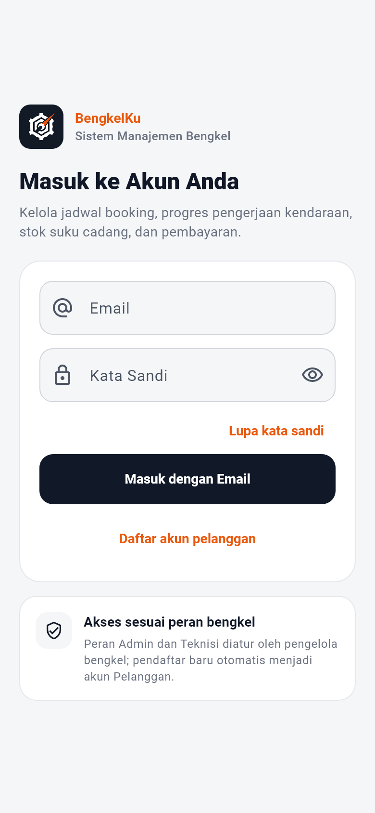 | 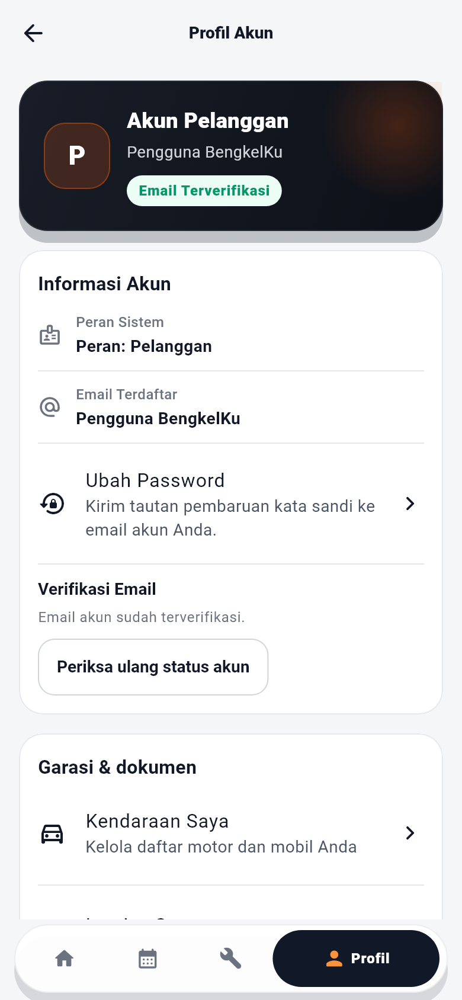 |

### Customer Experience
| Customer Home | Booking Form | Vehicle Garage |
| :---: | :---: | :---: |
| 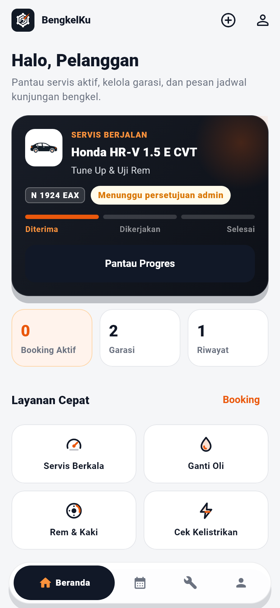 | 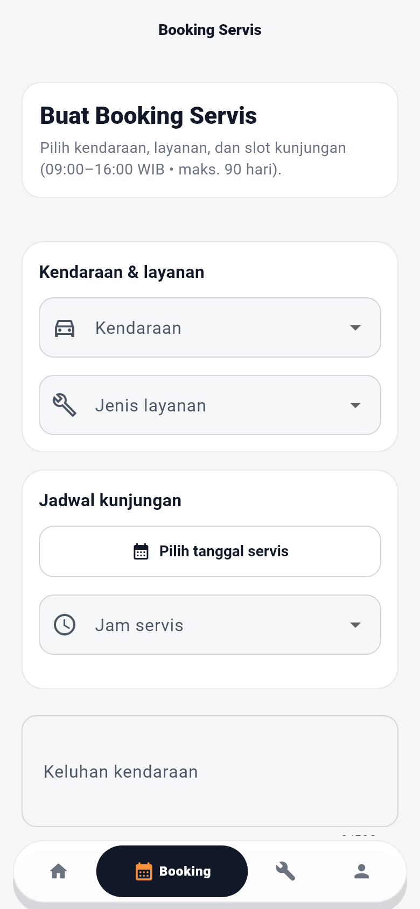 | 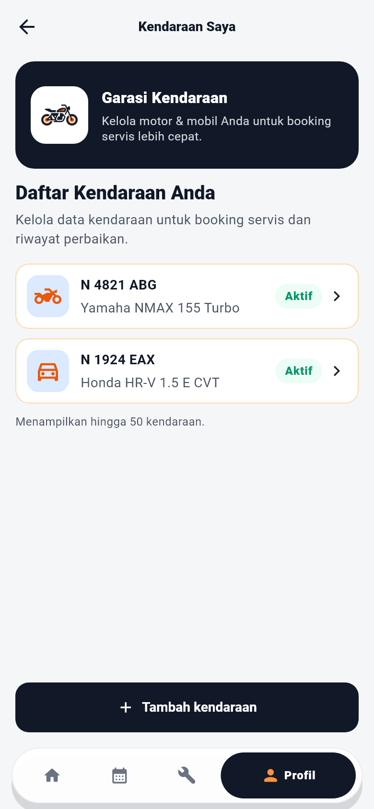 |

### Admin & Cashier Operations
| Admin Dashboard | Service Orders | Inventory Spareparts | Cashier & Invoices |
| :---: | :---: | :---: | :---: |
| 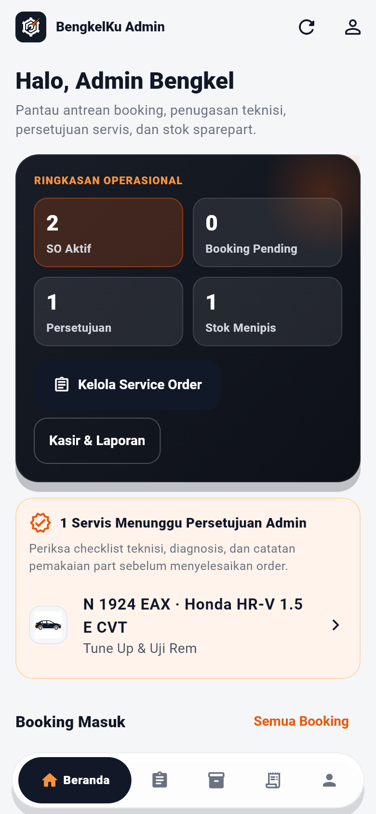 | 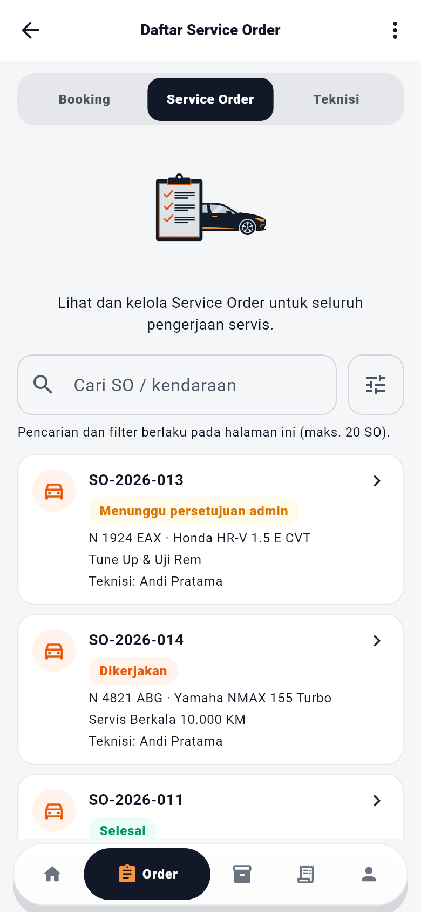 | 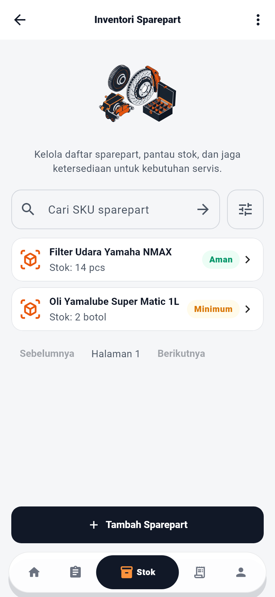 | 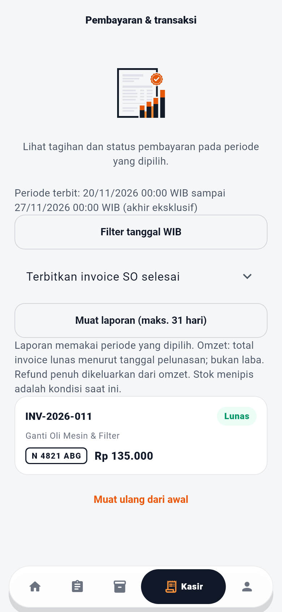 |

### Technician Workspace
| Technician Home | Technician Jobs |
| :---: | :---: |
| 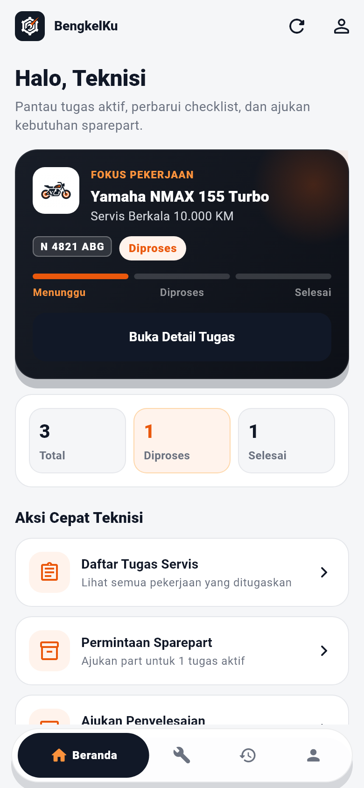 | 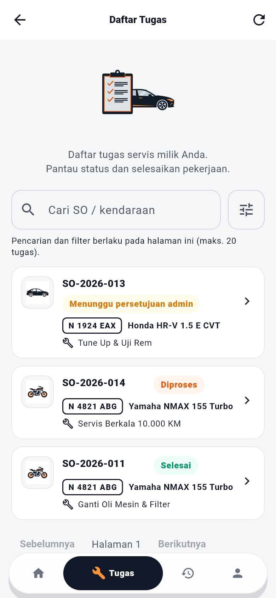 |

---

## Architecture & Tech Stack

```text
lib/
├── app/
│   ├── router/app_router.dart         # GoRouter + sessionRedirect() cross-role route guard
│   └── theme/                         # Crisp Automotive palette, spacing tokens & Material 3 theme
├── core/
│   ├── constants/                     # UserRole enum & permission labels
│   ├── data/                          # Firestore repositories (atomic bookings, SO, inventory, PDF invoices, reports)
│   ├── models/                        # Immutable domain models (Booking, Vehicle, ServiceOrder, Sparepart, Invoice)
│   └── widgets/                       # Crisp components, MobileNavigation pill bar, error mapper, splash
└── features/
    ├── auth/                          # Login, registration, verification, profile
    ├── customer/                      # Customer dashboard, booking, garage, service history
    ├── admin/                         # Admin bookings wrapper
    ├── technician/                    # Technician overview, service orders, checklist, completion, staff management
    ├── inventory/                     # Spareparts catalog, stock adjustments, part requests, ledger
    └── payments/                      # Invoice issuance, cashier payments, void/refund, revenue reports
```

- **State Management**: `flutter_riverpod` (`^3.4.3`)
- **Routing & Guards**: `go_router` (`^18.0.2`) enforcing role-scoped path isolation (`/{role}/...`)
- **Backend & Security**: `firebase_core`, `firebase_auth`, `cloud_firestore` paired with strict `firestore.rules`
- **Document Export**: `pdf` & `printing` using Crisp branding and bundled `NotoSans` fonts

### Cloud Firestore Security & Data Integrity
- **Collision-Free Scheduling**: Booking creation atomically claims `/bookingSlots/{slotMillis}` inside the transaction.
- **Optimistic Concurrency & 2-Step Approval**: Every `serviceOrders/{id}` mutation increments `revision`, appends an immutable audit record under `events/{revision}`, and requires admin sign-off before marking `completed` or decrementing stock from `partRequests`.
- **Hardened Configuration**: `android:allowBackup="false"` in `AndroidManifest.xml`, and tightened `/invoices/{id}` `allow get` rules ensuring customers can only probe non-existent invoice documents tied to their own `serviceOrders/{id}`.

---

## Getting Started

1. **Prerequisites**: Flutter SDK (Dart 3.11+), Android Studio / SDK, and Firebase configuration (`docs/FIREBASE_SETUP.md`).
2. **Install dependencies**:
   ```bash
   flutter pub get
   ```
3. **Run static analysis & full automated test suite**:
   ```bash
   flutter analyze --no-pub
   flutter test
   ```
4. **Regenerate UI showcase screenshots** (optional):
   ```bash
   flutter test --dart-define=CAPTURE_UI=true test/crisp_screenshots_test.dart
   ```
5. **Run on Android emulator/device**:
   ```bash
   flutter run
   ```

---

## Release Build & GitHub Distribution

1. **Configure private Android signing** (already excluded in `.gitignore` via `*.jks` and `/android/key.properties`):
   ```properties
   # android/key.properties
   storePassword=<keystore-password>
   keyPassword=<key-password>
   keyAlias=bengkelku
   storeFile=bengkelku-release.jks
   ```
2. **Build a signed release APK**:
   ```bash
   flutter build apk --release
   ```
   Output artifact: `build/app/outputs/flutter-apk/app-release.apk`.
3. **Publish on GitHub Releases**:
   ```bash
   gh release create v1.0.0 build/app/outputs/flutter-apk/app-release.apk --title "BengkelKu v1.0.0" --generate-notes
   ```

---

## Verification Status

- `dart format --output=none --set-exit-if-changed .`: **Clean**
- `flutter analyze --no-pub`: **0 issues found**
- `flutter test`: **All 150 tests passing** (unit logic, RBAC routing, hard delete for master entities, responsive `320dp` & `200%` text scaling across all role screens, Firestore fakes, inventory ledger, and Crisp Automotive UI widgets)
- Firebase Security Rules Emulator tests (`test_rules/*.test.cjs`): Updated with invoice existence-guard and master-entity delete tests; validated on GitHub Actions (`qa.yml`) with Java 21 + Firebase Local Emulator Suite.
